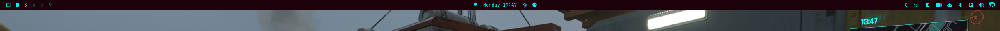
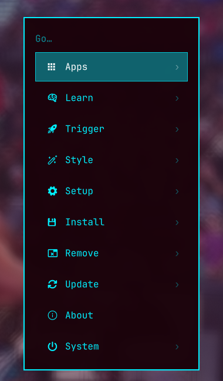

# ⚡ Cyberpunk Scarlet Protocol Rice

> **Cyberpunk Scarlet Protocol** es una personalización completa (rice) para **Hyprland** y el ecosistema **Omarchy (Quickshell)**, inspirada en una estética cyberpunk de alto contraste: fondos escarlata profundo (`#1c030b`), bordes y elementos en píldoras cian eléctrico brillante (`#00f0ff`), acentos carmesí neón (`#ff2a6d`) y tipografía blanca pura (`#ffffff`) para máxima legibilidad.

---

## 📸 Capturas de Pantalla

### 🖥️ Barra Superior y Espacios de Trabajo
Barra superior en tono escarlata, elementos envueltos en cápsulas cyberpunk cian, píldora con nombre de ventana activa y selector de workspaces en cápsulas circulares con dígitos blancos de alto contraste.


### 💀 Menú del Sistema Cyberpunk
Bordes en cian brillante, tipografía cian, opción seleccionada con fondo cian translúcido e íconos/texto en blanco puro, junto con el ícono personalizado de calavera mohawk punk en el launcher.


---

## ✨ Características Principales

- **Barra Superior Cyberpunk (`sergio.bar`)**:
  - Color de fondo: Escarlata profundo (`#1c030b`).
  - Todos los widgets y elementos envueltos en píldoras con borde cian eléctrico (`#00f0ff`).
  - Ícono del menú con calavera punk mohawk en cian neón.
- **Píldora de Ventana Activa (`sergio.active-window`)**:
  - Píldora en la barra superior que muestra el nombre de la app en primer plano en tiempo real.
  - Indicador de estado con punto brillante en cian neón.
- **Espacios de Trabajo (`im0001gt.screens.workspaces`)**:
  - Cápsulas individuales con borde cian brillante.
  - Números de espacio inactivos en cian eléctrico y números de espacio activo/enfocado en **blanco puro en negrita (`#ffffff`)** para lectura instantánea.
- **Menú y Launcher Estilizados (`shell.toml`)**:
  - Bordes exteriores en cian eléctrico de 2px.
  - Texto e íconos en cian eléctrico brillante.
  - Al posicionarse sobre cualquier elemento: fondo cian translúcido (`alpha = 0.4`), borde de selección cian y texto/icono en blanco puro.
- **Hyprland Optimizado**:
  - Reglas de ventanas para juegos (Cyberpunk 2077, World of Warcraft, etc.).
  - Desenfoque (*blur*) en capas de barra, ventanas y menús.
  - Integración nativa con visualizador de audio de escritorio (`SUPER + M`).
- **Terminales Sincronizadas**:
  - Configuraciones listas para **Alacritty** y **Kitty** utilizando la paleta Cyberpunk Scarlet Protocol.

---

## 🎨 Paleta de Colores

| Rol | Color Hex | Muestra |
| :--- | :--- | :--- |
| **Fondo Barra / Menú** | `#1c030b` / `#2e0612` |  Escarlata Profundo |
| **Acento Primario / Bordes** | `#00f0ff` |  Cian Eléctrico |
| **Texto Seleccionado / Foco** | `#ffffff` |  Blanco Puro |
| **Acento Secundario** | `#ff2a6d` |  Carmesí Neón |
| **Fondo de Selección** | `#00f0ff` (alpha 0.4) |  Resplandor Cian |

---

## 📂 Estructura del Repositorio

```text
scarlet-protocol-rice/
├── config/
│   ├── hypr/                        # Configuraciones de Hyprland (bindings, monitors, overrides)
│   ├── omarchy/
│   │   ├── shell.toml               # Tokens de colores globales para Quickshell
│   │   ├── shell.json               # Layout y módulos de la barra superior
│   │   ├── themes/scarletprotocol/  # Tema completo (fondos, neovim, btop, etc.)
│   │   └── plugins/
│   │       ├── sergio.bar/          # Barra superior con cápsulas cian
│   │       ├── sergio.menu/         # Widget del menú con calavera punk
│   │       ├── sergio.active-window/# Píldora de app activa en primer plano
│   │       └── im0001gt.screens.workspaces/ # Workspaces con números blancos en foco
│   ├── alacritty/                   # Configuración de terminal Alacritty
│   └── kitty/                       # Configuración de terminal Kitty
├── bin/                             # Scripts auxiliares (AudioViewer toggles)
├── screenshots/                     # Capturas de pantalla para documentación
├── install.sh                       # Script de instalación con respaldo automático
└── README.md
```

---

## 🚀 Instalación

### Prerrequisitos
- Distribución basada en Arch Linux con **Hyprland** instalado.
- Entorno de shell **Omarchy** con **Quickshell**.
- Fuentes: **JetBrainsMono Nerd Font**.

### Pasos de Instalación

1. Clona este repositorio:
```bash
git clone https://github.com/AkumaRyujin/scarlet-protocol-rice.git
cd scarlet-protocol-rice
```

2. Haz el script ejecutable (si no lo está):
```bash
chmod +x install.sh
```

3. Ejecuta la instalación:
```bash
./install.sh
```

> **Nota:** El instalador crea automáticamente una copia de seguridad timestamped de tus configuraciones existentes en `~/.config/rice_backups_<fecha>` antes de copiar los archivos.

### Opciones del Instalador

- Probar sin realizar cambios:
```bash
./install.sh --dry-run
```
- Instalar sin crear copia de seguridad:
```bash
./install.sh --no-backup
```
- Instalar sin recargar automáticamente la sesión:
```bash
./install.sh --no-reload
```

---

## ⌨️ Atajos de Teclado Destacados

| Atajo | Acción |
| :--- | :--- |
| `SUPER + SPACE` | Abrir / Cerrar Menú de Omarchy |
| `SUPER + ALT + SPACE` | Menú rápido de aplicaciones |
| `SUPER + M` | Activar / Desactivar Visualizador de Audio (AudioViewer) |
| `SUPER + ESCAPE` | Menú del sistema (Power / Session) |
| `SUPER + K` | Visor de atajos de teclado |
| `SUPER + SLASH` | Escalar monitor hacia arriba |
| `SUPER + ALT + SLASH` | Escalar monitor hacia abajo |

---

## 👤 Autor

Creado y mantenido por **[AkumaRyujin](https://github.com/AkumaRyujin)**.
Licencia MIT.
